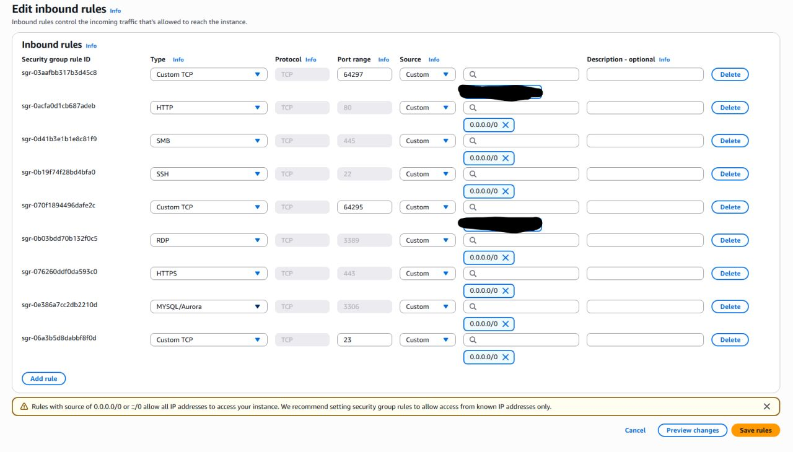

# Cloud Threat Intelligence & Honeypot Cluster (AWS + T-Pot)

A cloud-native multi-service honeypot deployed on AWS EC2 to capture, parse, and analyze automated reconnaissance, credential spraying, and exploit attempts from public internet traffic.

---

## Architecture Overview

- **Cloud Platform:** Amazon Web Services (AWS)
- **Compute Instance:** EC2 `m7i-flex.large` (2 vCPUs, 8 GB RAM)
- **Operating System:** Ubuntu 24.04 LTS
- **Storage:** 100 GB `gp3` EBS volume (resized via `growpart` and `resize2fs`)
- **Container Framework:** T-Pot (Docker & Docker Compose running 20+ microservices)
- **SIEM / Telemetry Pipeline:** ELK Stack (Elasticsearch, Logstash, Kibana) + Suricata NIDS

---

## Network Architecture & Operational Security (OpSec)

To balance adversary exposure with administrative isolation, network ingress was segmented into two distinct security profiles within the AWS Security Group:

1. **Trap / Decoy Ingress (`0.0.0.0/0`):** Exposing common target services globally to invite automated scanning noise:
   - Port 21 (FTP)
   - Port 22 (SSH - routed to Cowrie)
   - Port 80 / 443 (HTTP/HTTPS)
   - Port 445 (SMB - routed to Dionaea)
   - Port 3389 (RDP)
   - Port 3306 (MySQL)
2. **Management Plane Isolation:** 
   - Management SSH remapped from port 22 to TCP `64295`.
   - Web management dashboard remapped to TCP `64297`.
   - Both management ports strictly restricted to an authorized management IP.



---

## Deployment & System Engineering

1. **Host Provisioning:** Deployed an EC2 instance sized to handle Elasticsearch JVM memory requirements.
2. **Storage Management:** Expanded the root volume to 100 GB `gp3` to handle high-frequency index writes without disk exhaustion:
   ```bash
   sudo growpart /dev/nvme0n1 1
   sudo resize2fs /dev/nvme0n1p1
3. **Cluster Initialization:** Executed T-Pot automated installer, configuring Docker bridges, log pipelines, and systemd service units.

---

## Threat Telemetry & Analysis

### 1. Global Reconnaissance & Port Activity
Within 24 hours of exposing the public IPv4 address, automated scanners and botnets recorded over 1,000 distinct attack attempts spanning multiple continents.


- **Primary Targets:** SSH (Port 22) and SMB (Port 445) accounted for the overwhelming majority of ingress attempts.
- **Top Geographic Origins:** Concentrated scanner traffic originating from nodes across the United States, the Netherlands, Brazil, and East Asia.

### 2. High-Velocity SSH Brute-Forcing (Cowrie)
Cowrie captured interactive session attempts, brute-force dictionaries, and client software fingerprints.


- **Credential Spraying:** Attackers almost exclusively brute-forced standard default accounts (`root`, `admin`), attempting high-frequency dictionary passwords including `54321`, `(blank)`/null entries, and default vendor passwords (`123456`, `password`).
- **HASSH Client Fingerprinting:** By computing MD5 hashes of the initial SSH key exchange and cipher list, scanners were fingerprinted independently of rotating source IP addresses.

### 3. Network Intrusion Detection & TLS Fingerprinting (Suricata)
Suricata provided packet-level inspection and traffic anomaly classification prior to service engagement.


- **User-Agent Masquerading:** Attackers frequently forged browser User-Agent headers to blend with legitimate HTTP traffic.
- **JA3 / JA4 Fingerprinting:** TLS handshake profiling identified underlying automation engines (e.g., Python scripts, Go HTTP clients, zgrab scanners) regardless of forged application-layer headers.

---

## Key Takeaways

1. **Perimeter Scanning is Continuous:** Unhardened endpoints exposed to the public internet are discovered and probed by automated scanners within minutes.
2. **Management Ports Must Never Face the Public Internet:** Standard service ports (22, 3389) are subjected to non-stop dictionary attacks; administrative access should always be routed through non-standard ports, VPNs, or IP whitelisting.
3. **Payload-Agnostic Fingerprinting:** In an era where attackers easily rotate IPs and forge user agents, cryptographic client profiling (JA3, JA4, HASSH) is critical for effective threat identification.
